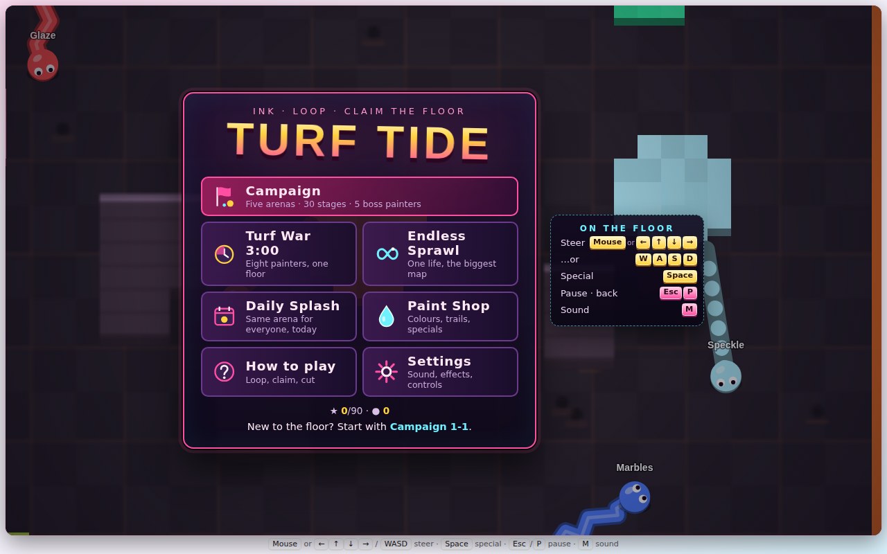
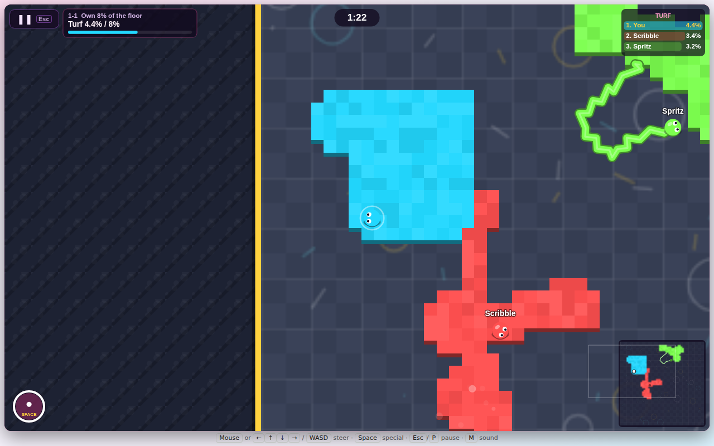
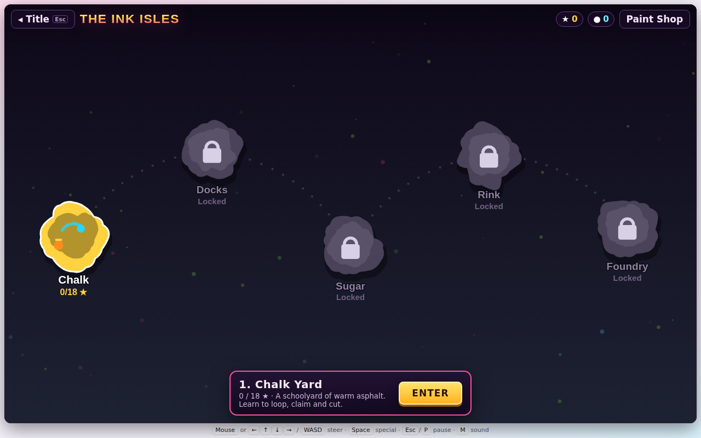
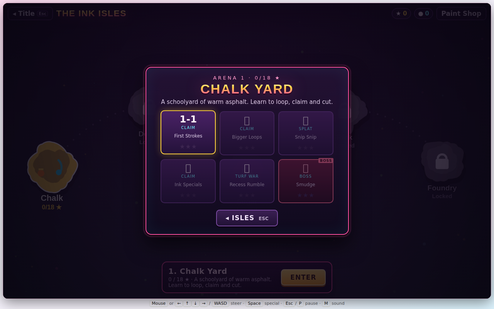
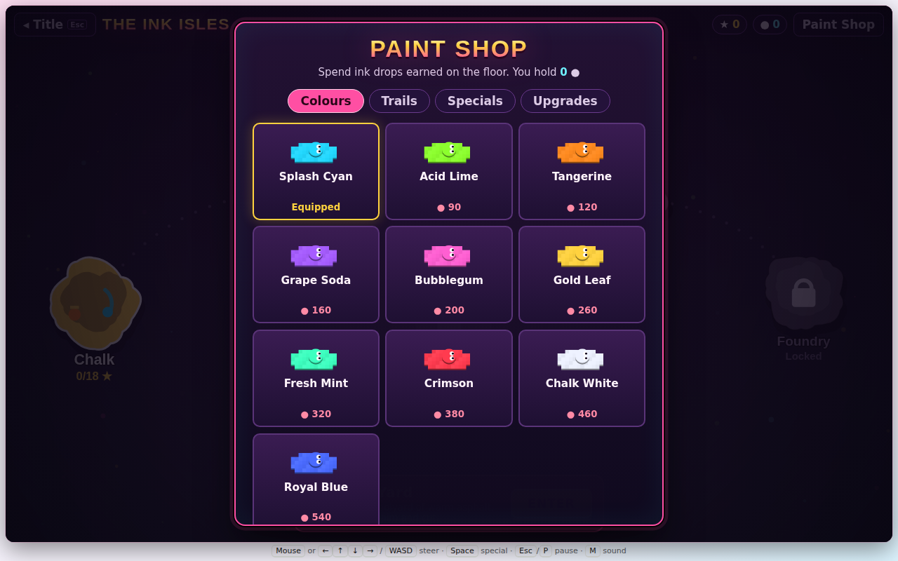
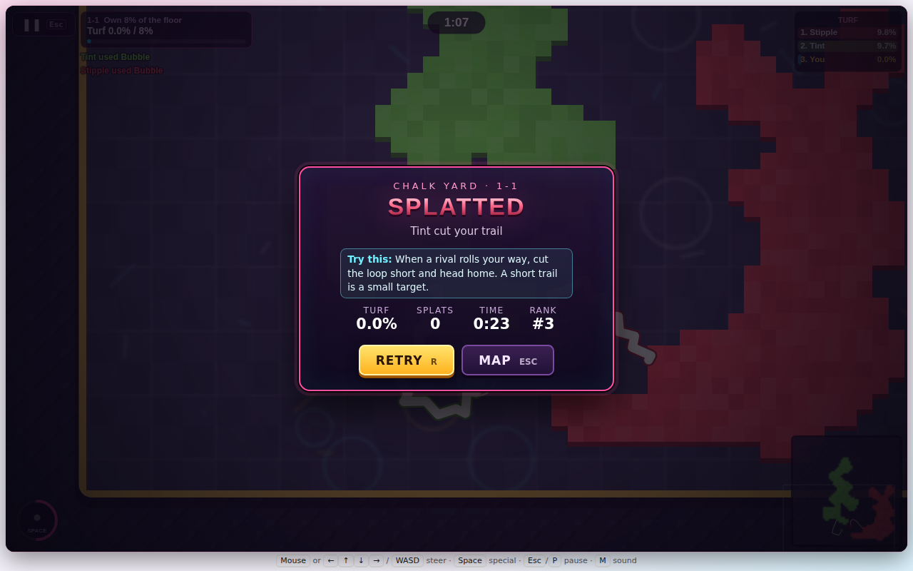

# Turf Tide

**Five ink isles, 30 stages, bosses at double speed. Loop to claim, cut trails to splat them.**

<p align="center">
  
</p>

<p align="center">
  <a href="https://ai-llm-2030.github.io/TrueMarch_Games_Turf_Tide/"><b>▶ Play Turf Tide in your browser</b></a>
</p>

## Gameplay

<p align="center">
  
</p>

## More screenshots

<table>
<tr><td width="50%"><br><sub>The ink isles</sub></td><td width="50%"><br><sub>Chalk Yard's stages</sub></td></tr>
<tr><td width="50%"><br><sub>The Paint Shop</sub></td><td width="50%"><br><sub>Splatted: a stage result</sub></td></tr>
</table>

## Controls

| Keys | Action |
|---|---|
| Mouse, ← ↑ ↓ → or W A S D | Steer |
| Space | Special |
| Esc / P | Pause |
| M | Sound on / off |

## Run it yourself

No install, no build step, no server code, no network. The game runs entirely in your browser and keeps your progress in the browser's local storage.

```bash
git clone https://github.com/ai-llm-2030/TrueMarch_Games_Turf_Tide.git
cd TrueMarch_Games_Turf_Tide
python3 -m http.server 8000
# open http://localhost:8000
```

Opening `index.html` directly works too in most browsers; a local server is the most reliable way.

## What's inside

```
TrueMarch_Games_Turf_Tide/
├── index.html        the whole game: one file, plain JavaScript and <canvas>
├── lib/
│   ├── arcade.js     shared helpers: crisp canvas, frame loop, input, theme
│   └── arcade.css    shared look
├── assets/           the pictures in this README
├── LICENSE
└── README.md
```

Written from scratch in vanilla JavaScript: every sprite, background and sound is drawn or synthesised in code (Canvas 2D and the Web Audio API). No libraries, no frameworks, no third-party assets.

## More TrueMarch games

29 more standalone games from TrueMarch, each free to play in the browser.

| Game | What you do | |
|---|---|---|
| [Gustwing](https://github.com/ai-llm-2030/TrueMarch_Games_Gustwing) | One button, four skies, 24 courses: bees, boulders, icicles and sparks, eddies that lift and drop you, and shields, magnets and feather-fall. Thread the spires, break the storm. | [play](https://ai-llm-2030.github.io/TrueMarch_Games_Gustwing/) |
| [Riff Rivals](https://github.com/ai-llm-2030/TrueMarch_Games_Riff_Rivals) | Five rivals, 20 sing-off duels. Hear the call, answer it note for note, and push the health bar their way. | [play](https://ai-llm-2030.github.io/TrueMarch_Games_Riff_Rivals/) |
| [Hopscotch Highway](https://github.com/ai-llm-2030/TrueMarch_Games_Hopscotch_Highway) | Hop the endless highway: roads, rivers, rails and a hawk that hates waiting. Four lands, 32 stages, 25 hoppers. | [play](https://ai-llm-2030.github.io/TrueMarch_Games_Hopscotch_Highway/) |
| [Ember Keep](https://github.com/ai-llm-2030/TrueMarch_Games_Ember_Keep) | A flame-knight's campaign: five worlds, bosses, relics and time medals. | [play](https://ai-llm-2030.github.io/TrueMarch_Games_Ember_Keep/) |
| [Starhive](https://github.com/ai-llm-2030/TrueMarch_Games_Starhive) | Four sectors, 36 stages, a tractor beam that steals your ship. Win it back mid-dive and fly double. | [play](https://ai-llm-2030.github.io/TrueMarch_Games_Starhive/) |
| [Ashen Depths](https://github.com/ai-llm-2030/TrueMarch_Games_Ashen_Depths) | Delve five cursed deeps: loot, spells, bosses and a dungeon new every time. | [play](https://ai-llm-2030.github.io/TrueMarch_Games_Ashen_Depths/) |
| [Neon Noughts](https://github.com/ai-llm-2030/TrueMarch_Games_Neon_Noughts) | Twenty neon rivals, nine-board Ultimate, fading marks and gravity. Out-think the Gridmaster. | [play](https://ai-llm-2030.github.io/TrueMarch_Games_Neon_Noughts/) |
| [Five Horizons](https://github.com/ai-llm-2030/TrueMarch_Games_Five_Horizons) | Sunny coast racing against the clock: 15 stages, a fork after each, 5 endings, missions & 6 cars. | [play](https://ai-llm-2030.github.io/TrueMarch_Games_Five_Horizons/) |
| [Nebula Strike](https://github.com/ai-llm-2030/TrueMarch_Games_Nebula_Strike) | Four star systems, multi-phase bosses, medals and a hangar to upgrade. | [play](https://ai-llm-2030.github.io/TrueMarch_Games_Nebula_Strike/) |
| [Nestwood](https://github.com/ai-llm-2030/TrueMarch_Games_Nestwood) | Merge bits into furniture on the floor itself: each finished piece stays where you made it, so you decorate a treehouse inn room by room. | [play](https://ai-llm-2030.github.io/TrueMarch_Games_Nestwood/) |
| [Called Shot](https://github.com/ai-llm-2030/TrueMarch_Games_Called_Shot) | Time the pitch and swing for the fences in small-town America, and call your shot at the water tower before you hit it. | [play](https://ai-llm-2030.github.io/TrueMarch_Games_Called_Shot/) |
| [Aurora Ice](https://github.com/ai-llm-2030/TrueMarch_Games_Aurora_Ice) | Skate to the music: land jumps on the beat, spin on the spot, and paint a heart, a star or a swan on the ice with your blades. | [play](https://ai-llm-2030.github.io/TrueMarch_Games_Aurora_Ice/) |
| [Saqr](https://github.com/ai-llm-2030/TrueMarch_Games_Saqr) | Emirati falconry in the dunes: ride the thermals, stoop steep, chase down hare and houbara, then fly two falcons together. | [play](https://ai-llm-2030.github.io/TrueMarch_Games_Saqr/) |
| [Petal & Pine](https://github.com/ai-llm-2030/TrueMarch_Games_Petal_and_Pine) | Hanafuda Koi-Koi in a Kyoto townhouse: match the months' flower cards, make a yaku, then dare to call Koi-Koi and play on. | [play](https://ai-llm-2030.github.io/TrueMarch_Games_Petal_and_Pine/) |
| [Lanternsong](https://github.com/ai-llm-2030/TrueMarch_Games_Lanternsong) | Five lit worlds, 30 public-domain songs. Repeat the melody note by note, or tap it as tiles. | [play](https://ai-llm-2030.github.io/TrueMarch_Games_Lanternsong/) |
| [Comet Breaker](https://github.com/ai-llm-2030/TrueMarch_Games_Comet_Breaker) | Four glass worlds, 32 stages, bosses that shoot back. Catch the capsules, dodge the grey one. | [play](https://ai-llm-2030.github.io/TrueMarch_Games_Comet_Breaker/) |
| [Tumbleberry](https://github.com/ai-llm-2030/TrueMarch_Games_Tumbleberry) | Four worlds, 16 levels, a castle boss at the end of each. Bop the blocks, grab the Muffin, find all three big coins. | [play](https://ai-llm-2030.github.io/TrueMarch_Games_Tumbleberry/) |
| [Confetti & Co.](https://github.com/ai-llm-2030/TrueMarch_Games_Confetti_and_Co) | Seat the guests by friendships and feuds, then watch your party play out live and spend a few clever moments to save the night. | [play](https://ai-llm-2030.github.io/TrueMarch_Games_Confetti_and_Co/) |
| [Bells Break](https://github.com/ai-llm-2030/TrueMarch_Games_Bells_Break) | Surfing an Australian point break: floaters, aerials and deep barrels, then real heats against rivals who hold priority and steal your favourite wave. | [play](https://ai-llm-2030.github.io/TrueMarch_Games_Bells_Break/) |
| [Gemsworn](https://github.com/ai-llm-2030/TrueMarch_Games_Gemsworn) | Five realms, 35 duels, one shared board. Match skulls to strike, gems to charge spells. | [play](https://ai-llm-2030.github.io/TrueMarch_Games_Gemsworn/) |
| [Glowcoil](https://github.com/ai-llm-2030/TrueMarch_Games_Glowcoil) | Steer a glowing serpent through 30 arena stages, cut rivals off and fell 5 Titans. | [play](https://ai-llm-2030.github.io/TrueMarch_Games_Glowcoil/) |
| [Lumen Lines](https://github.com/ai-llm-2030/TrueMarch_Games_Lumen_Lines) | Nine lit districts, 270 one-answer puzzles. Bridges, hexes, warps and shapes, a showpiece closing each. | [play](https://ai-llm-2030.github.io/TrueMarch_Games_Lumen_Lines/) |
| [Rivet & Crate](https://github.com/ai-llm-2030/TrueMarch_Games_Rivet_and_Crate) | Five warehouses, 50 stages, a foreman drone with opinions. Push, never pull. | [play](https://ai-llm-2030.github.io/TrueMarch_Games_Rivet_and_Crate/) |
| [Quiltmaker](https://github.com/ai-llm-2030/TrueMarch_Games_Quiltmaker) | Picture logic puzzles: read the numbers, stitch the squares, and sew a village's story quilt patch by patch. | [play](https://ai-llm-2030.github.io/TrueMarch_Games_Quiltmaker/) |
| [Hurry Hard](https://github.com/ai-llm-2030/TrueMarch_Games_Hurry_Hard) | Curling on a prairie rink: set the weight and the curl, release, then sweep like mad to carry your stone into the house. | [play](https://ai-llm-2030.github.io/TrueMarch_Games_Hurry_Hard/) |
| [Treble Top](https://github.com/ai-llm-2030/TrueMarch_Games_Treble_Top) | Pub darts, 501 to a double: steady your nerves with one held breath and throw for the treble twenty. | [play](https://ai-llm-2030.github.io/TrueMarch_Games_Treble_Top/) |
| [Gully Sixes](https://github.com/ai-llm-2030/TrueMarch_Games_Gully_Sixes) | Street cricket in a Mumbai gully: move your feet to the length, steal quick singles and dance down to spin while the captain moves the field to your shots. | [play](https://ai-llm-2030.github.io/TrueMarch_Games_Gully_Sixes/) |
| [Kubb Kings](https://github.com/ai-llm-2030/TrueMarch_Games_Kubb_Kings) | Kubb, the Swedish lawn game: throw straight, stack field kubbs into towers and fell the king from the half-line against a rival who finds your weak side. | [play](https://ai-llm-2030.github.io/TrueMarch_Games_Kubb_Kings/) |
| [Saffron Road](https://github.com/ai-llm-2030/TrueMarch_Games_Saffron_Road) | Backgammon as a caravan race between two oases: walk your camels home, raise the Wager Lantern, and win a seat on the Saffron Council. | [play](https://ai-llm-2030.github.io/TrueMarch_Games_Saffron_Road/) |

## About

**Turf Tide** is one of the 120+ games made by **[TrueMarch](https://truemarch.com)**. This repository is the standalone single-player edition of the game.

## License

© 2026 TrueMarch. All rights reserved. The source is published so you can read it, learn from it and play the game; see [LICENSE](LICENSE).
